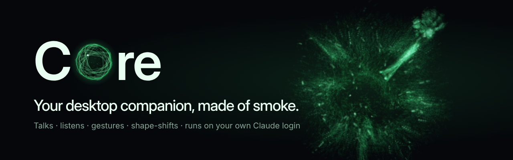

# COre



A desktop companion that lives on your screen as a **sphere of glowing smoke**. It talks with a deep robotic
voice (sarcastic by default), listens, looks at your screen when you ask, points at things with smoke hands,
gestures, forms emoji out of its smoke, chats when things are quiet, splits into helper copies to multitask,
and updates itself.

Its brain is **Claude through your own Claude Code login**, so it needs no API key. Free fallbacks (Gemini,
Groq, OpenRouter, a local Ollama model, or any OpenAI-compatible endpoint) take over when Claude is unavailable.

## Install

### Windows installer

> **Status:** installers published before the new release process (v2.0.0 – v10.2.0) are incomplete: some
> contain only a `.blockmap`, and none can update itself. Until a release built by the new gated process
> is published, **install from source** (below). See [docs/dev/RELEASING.md](docs/dev/RELEASING.md).

A verified release contains **COre-Setup-x.y.z.exe**, `latest.yml` and `SHA256SUMS.txt`. Run the installer to
get Start-menu and desktop shortcuts and a normal uninstaller (Windows Settings → Apps, or COre's Settings →
Maintenance → Uninstall). Installed copies then update themselves from published releases.

For the Claude brain, install [Claude Code](https://docs.claude.com/en/docs/claude-code) and log in once.
COre's chat shows a **Log in to Claude** button if you aren't logged in.

### From source

You need **Node.js 20+**. On Windows you can unzip the folder and double-click **Install COre.bat** instead:
it installs Node.js and Claude Code if they're missing and puts a shortcut on your Desktop.

```bash
npm install
```

```bash
npm start
```

Source copies update themselves from **published releases** (backed up first, rolled back automatically if
an update fails or won't start). Developers can switch to the `main` channel in Settings → Privacy. The first time you talk, COre downloads its speech
recognition (~80 MB) and voice (~90 MB) models once. Both then run offline on your PC.

> **Black box behind the orb?** Some graphics drivers can't draw transparent windows on the GPU. COre notices
> and restarts in *safe graphics mode*. You can also pick it in Settings → Look → Graphics mode, or in the tray menu.

## Use

| Do this | And COre… |
|---|---|
| `Ctrl+Alt+Space` | listens; press again to stop early (or set "press again to send" in Settings) |
| Press and hold the orb | listens while you hold, sends when you let go |
| "Hey COre" (optional) | wakes hands-free; "Hey COre, what time is it?" works in one breath |
| `Ctrl+Alt+S` | talks about your screen (gets a screenshot, can point at things) |
| `Ctrl+Alt+C` | shows/hides the chat under the orb |
| `Ctrl+Alt+H` | hides/shows COre (it dissolves into smoke) |
| Type in the chat | answers like a normal Claude chat (markdown, code), read aloud as it goes |
| Drag / click the orb | moves it / toggles the chat |

All shortcuts can be changed in **Settings** (tray menu → Settings…, or ⚙ → All settings… in the chat).

## What it can do

**Talk and listen.** Kokoro neural voice through a robot effects chain (ring mod, flanger, detuned double),
with words revealed in step with the audio. Pick the tone (sarcastic, dramatic, calm, cheerful,
professional), voice, pitch, robot amount and **reply language**. Speech recognition is local Whisper.

**Hands-free (optional).** Turn on "Hey COre" in Settings → Voice or the tray. A tiny detector only passes
short phrases after a pause to the local speech model; nothing leaves your PC. Talk over COre to interrupt it
(barge-in). **Conversation mode** keeps listening for a few seconds after each spoken reply.

**Body language.** 30 gestures made of the same smoke arms: wave, thumbs up/down, shrug, count to five,
clap, facepalm, point in four directions, beckon, stop, OK, peace, rock, heart hands, think, salute, fist pump,
celebrate, juggle, hug, magic, flex, bow, nod, shake, spin, bounce. COre picks them while it talks.

**Shape-shifting.** The smoke forms shapes with matching sounds: a laughing face that giggles, a heart that
hums, a check mark that dings, a frown that sighs, plus stars, arrows, music notes, a light bulb, Zzz, and any
one to three letters or digits.

**Presence.** After a quiet while COre starts a short, relevant conversation. It only does this when you're
at the computer but paused, never in quiet hours, at most a few times a day, and it backs off when ignored.
Pet it, tickle it, poke it (double click) or toss it across the screen, and it reacts. Ask for **trivia, a
riddle or 20 questions**.

**Meiosis Mode: four cores, one chat.** COre coordinates three specialists that split off as smoke helpers:
**Scout** (research), **Forge** (build) and **Sentinel** (review/QA). Start a message with `@Scout`, `@Forge` or
`@Sentinel` (or pick one with the chip beside the input; `@` autocompletes) to talk to one directly. Address
several to run a shared task that COre then sums up. Every reply in the single chat is labelled with who
said it, subtitles name the speaker, and only one core speaks at a time. Specialists can't touch files or
the web yet. See [docs/dev/MEIOSIS.md](docs/dev/MEIOSIS.md).

**Screen partner.** When an error dialog, crash report or "(Not Responding)" window appears, COre offers a
**Take a look** button. It notices from window titles only; a screenshot is taken when you click. When it points
at something, the smoke finger snaps onto the nearest button or label. Summon it on another monitor and it moves there.

**Skills.** Notes, timers and reminders, weather (free Open-Meteo; set your city), music control
(play/pause/next/volume), opening apps from a safe list, web search buttons, and your calendar via a private
ICS link. Lookups come back as a spoken answer. **Plugins:** put JSON files in COre's data folder under
`skills/`, for example:

```json
{ "name": "wiki", "description": "search Wikipedia", "url": "https://en.wikipedia.org/wiki/Special:Search?search={q}" }
```

**Memory, clipboard, moods.** COre remembers facts about you across conversations (see or delete them in
⚙ → Memory), can work with what you copied ("explain what I copied"), and its smoke shows moods.

**Make it yours.** Seven smoke colours, size, density, performance profiles (Battery saver / Balanced / Best
quality), reduced motion (follows Windows), larger chat text, captions on or off, start with Windows.

**Notifications from anything.** COre listens on `127.0.0.1:47321` (token in the panel menu):

```bash
curl -X POST http://127.0.0.1:47321/notify -H "Authorization: Bearer YOUR_TOKEN" -H "content-type: application/json" -d '{"title":"Build finished","level":"success"}'
```

## Brains

COre tries brains in order and skips any that aren't connected (chat ⚙ → Brain, or Settings → Brain):

- **Claude** (default): Claude Code on your PC, kept running in the background so replies start in about a
  second. Haiku by default; Sonnet or Opus in Settings.
- **Google Gemini**, **Groq**, **OpenRouter**: free API keys (links in ⚙ → Brain). Keys are encrypted with your
  OS account before they're saved.
- **Local model (Ollama)**: fully offline. Press **Install Ollama**, then **Download model**.
- **Custom endpoint**: any OpenAI-compatible API (DeepSeek, LM Studio…) via `brain.openaiCompat` in `config.json`.

## Privacy and safety

- **Microphone:** opened only while COre listens, unless you turn on hands-free. Then it stays open, but only
  short phrases are checked, on your PC, for "Hey COre". Speech recognition and the voice are local.
- **Screen:** screenshots happen only on `Ctrl+Alt+S`, a "look at this" phrase, or a **Take a look** click. They're
  sent to the brain you chose; the last 5 stay in COre's workspace folder. Watch mode reads window titles only.
- **Claude:** COre runs `claude -p` with **no tools** in its persistent session (the per-message fallback may
  only `Read` the screenshot file), inside its own workspace, `--restricted` where supported. It never uses
  `--dangerously-skip-permissions` and cannot run commands.
- **Skills:** nothing runs a command built from the model's words. Apps and media keys come from fixed lists,
  links open only when you click, and plugins are data (https link templates), not code. Each skill can be
  switched off.
- **Crash reports** are written to COre's own logs folder and never uploaded.
- The notification endpoint is localhost-only and needs the per-install token.

## Settings and maintenance

Everything is in the **Settings** window: General, Look, Voice, Brain, Accessibility, Skills, Privacy, and
**Maintenance** (check for updates, copy diagnostics, open data/crash-log folders, replay the tour, restart,
reset, uninstall). Settings are saved in `config.json` in COre's data folder.

## How it works

```
 hotkeys / chat / wake phrase ─► main process (Electron)
   ├─ Brain chain: Claude Code CLI (persistent) ► Gemini / Groq / OpenRouter / Ollama / custom
   │    stream ► tag parser ► sentence chunker ► [say | gesture | form | skill | clone | end]
   ├─ Whisper STT + Kokoro TTS (worker threads, local)    ├─ skills (notes, weather, music, apps…)
   ├─ presence (chit-chat), watch mode, reminders, memory ├─ helper clones + speech floor
   ├─ settings window, updater (source: GitHub main; installer: Releases)
   └─ notify server 127.0.0.1:47321
                     │ IPC
 overlay window (transparent, always on top, click-through except over the orb; moves, never resizes while idle)
   ├─ orb-smoke.js  WebGL2 transform-feedback particles: flow on a sphere, filaments, smoke hands with
   │                moving fingers, shapes from a 64×32 target texture, trails, bloom
   ├─ motion.js / gestures.js / shapes.js / interactions.js
   ├─ voice.js      Kokoro audio ► robot chain ► analyser ► resonance; synthesized giggles/hums
   └─ listen.js / wake.js   mic + energy VAD ► 16 kHz PCM
```

The smoke uses simplex noise with analytic gradients by Ian McEwan and Stefan Gustavson (ashima/webgl-noise,
MIT). The liquid style uses signed-distance-field techniques from Inigo Quilez's articles.

## Brand

Logo, icons, banners, colours and voice: see [docs/BRAND.md](docs/BRAND.md).

## Develop

```bash
npm test
```

```bash
npm run check
```

```bash
npm run dist
```

`npm run dist` builds the Windows installer (run it on Windows; GitHub Actions builds and publishes it when
the version changes on `main`). To sign it, add `WINDOWS_CSC_LINK` (base64 .pfx) and `WINDOWS_CSC_KEY_PASSWORD`
secrets to the repository.

Open `src/renderer/overlay/index.html` in Chrome to play with the orb without Electron. Keys: P point, E explain,
T talk, L listen, K think, N notification colours, G next gesture, F next shape, 1–7 moods. Fixed poses for
screenshots: `?pose=point|explain|speaking|attention|move|gesture&g=wave|form&shape=laugh`, plus `&r=120` for
size and `&bg=light` for a light wallpaper.
