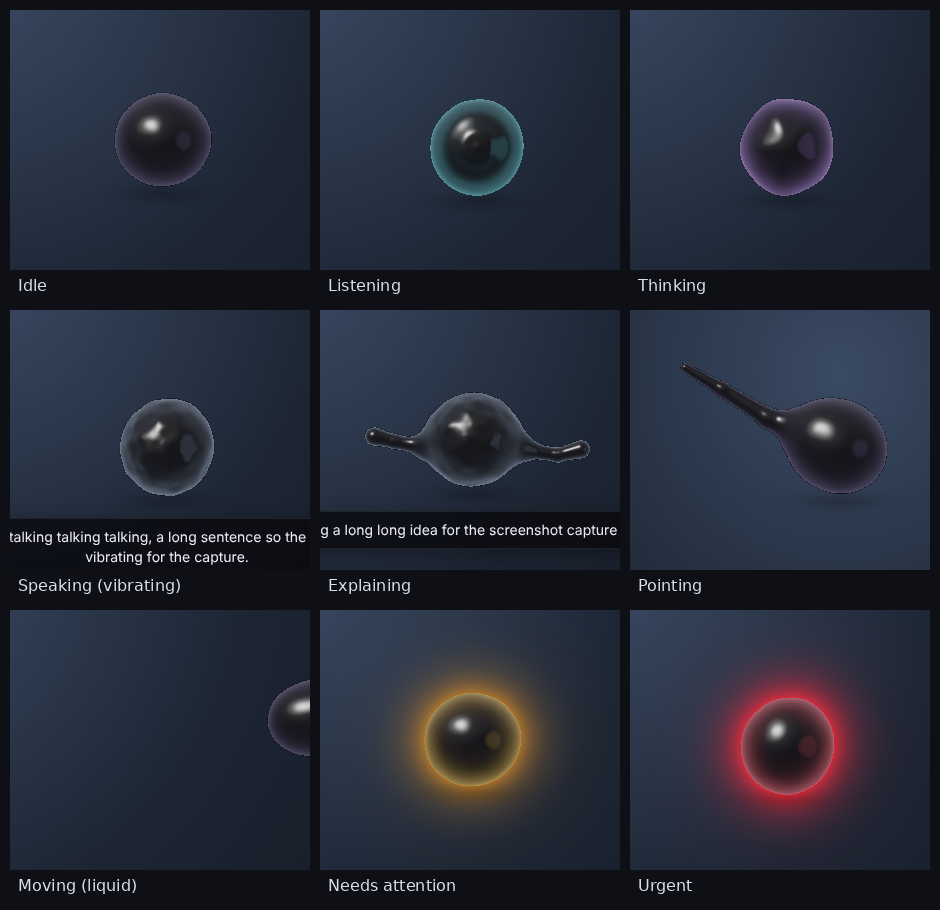

# COre



A desktop companion that lives on your screen as a **sphere of glowing green smoke**: thousands of particles
flowing over a shell, gathering into drifting filaments and resonating together.
It talks, listens, looks at your screen when you ask, reaches out **smoke tendrils to point** at things,
resonates while it speaks, trails smoke when it moves, and **changes colour** when something needs your attention.
It speaks with a **deep robotic machine voice** (sarcastic by default, adjustable), has a **chat block under the orb**
for normal Claude-style typed conversations, and **updates itself** from GitHub.

Its brain is **Claude through your own Claude Code login** — no API key. If Claude is unavailable it
falls back to a **free local model** (Ollama) or any OpenAI-compatible endpoint (DeepSeek, OpenRouter, LM Studio).

| State | Look |
|---|---|
| Idle | green smoke strands drifting over a hollow sphere, slowly turning |
| Listening | cyan, ripples with your voice |
| Thinking | violet, faster swirl |
| Speaking | the shell resonates in waves with the words, flow speeds up and brightens |
| Explaining / pointing | smoke arms end in smoke hands: an open hand with five flexing fingers, or an index finger that lands exactly on the target |
| Moving | the cloud lags behind its centre like smoke |
| Notification | colour change and pulsing halo: blue info, lime success, amber warning, red urgent |

## Install on Windows (easiest)

> **Black box behind the orb or chat?** Some graphics drivers can't do transparent windows on the GPU. COre detects
> this and restarts itself in *safe graphics mode* automatically; you can also pick it yourself in the chat's
> ⚙ → Display → Graphics (or the tray icon → Graphics). ⚙ → **Copy diagnostics** copies your GPU details for
> troubleshooting.

1. Unzip the folder somewhere permanent, for example `C:\Users\<you>\COre`.
2. Double-click **Install COre.bat**. It installs Node.js (via winget) and Claude Code if they are missing,
   installs COre, puts a **COre** shortcut on your Desktop, helps you log in to Claude once, and starts COre.
3. Next time, double-click **COre** on the Desktop (or **Start COre.bat**).

## Install manually

You need **Node.js 20+** and, for the Claude brain, **Claude Code** logged in once.

```bash
npm install -g @anthropic-ai/claude-code
```

```bash
claude
```

Inside Claude Code type `/login`, finish the login, then exit. (The native Claude Code installer works too.)

Then, in this folder:

```bash
npm install
```

```bash
npm start
```

`npm install` also downloads the Electron runtime. The first time you talk, COre downloads a small
speech-recognition model (Whisper base, ~80 MB) that then runs locally.

## Use

| Hotkey | Does |
|---|---|
| `Ctrl+Alt+Space` | Talk. Press again to stop early. Pressing while COre talks interrupts it. |
| `Ctrl+Alt+S` | Talk about your screen (COre gets a screenshot and can point at things) |
| `Ctrl+Alt+C` | Show / hide the chat block under the orb |
| `Ctrl+Alt+H` | Hide / show COre (a notification tells you it's hidden) |

- **Chat block:** type under the orb and COre answers like a normal Claude chat (full detail, lists, code blocks),
  in the same conversation as your voice chats. Only the opening of typed replies is read aloud (toggle in ⚙).
- **Drag** the orb anywhere; it remembers the spot and the chat follows. **Click** it to show or hide the chat.
- **Hover** or click acknowledges a notification colour.
- When COre looks at your screen it captures the monitor your mouse is on and also gets the list of every open
  window (minimised ones too), so it knows what's running even when it isn't visible.
- Phrases like "look at this", "what's on my screen", "where is the…" also share a screenshot automatically
  (turn off with `screen.autoShareOnDeixis`).
- Tray icon: talk, new conversation, settings, quit.

## Memory, reminders and actions

- **Memory:** tell COre about yourself and it remembers across conversations (any brain). It shows
  "🧠 Remembered: …" in the chat when it saves something. See or delete everything in ⚙ → Memory.
- **Reminders and timers:** "remind me in 20 minutes to stretch", "set a 5 minute timer", "remind me at 7pm to
  call mom". They survive restarts and fire with COre's voice, an amber glow and a Windows notification. Cancel
  them in ⚙ → Reminders.
- **One-click actions:** COre can offer to open a website or copy text. It shows a button in the chat and only
  acts when you click it.
- **Clipboard:** "explain what I copied", "fix the text in my clipboard".
- **Moods:** COre's smoke reacts to its replies (happy, amused, curious, annoyed, excited, sad, calm).
- **Presence:** the orb leans toward your cursor when you come near, and greets you on the first launch of the
  day (turn off with `personality.greeting: false`).

## Brains

With Claude, COre keeps one Claude Code session running in the background, so replies start in about a second
(no start-up per message). It keeps the conversation across restarts; ⚙ → New chat starts fresh.

COre tries brains in order and skips the ones that aren't connected. Open ⚙ in the chat block → **Brain**:

- **Claude** (default, no API key): uses Claude Code on your PC. Signing in to the Claude desktop app does not
  sign in Claude Code; press **Log in to Claude** once and finish the login in your browser.
- **Google Gemini** — free API key from [aistudio.google.com/apikey](https://aistudio.google.com/apikey). Can see screenshots.
- **Groq** — free API key from [console.groq.com/keys](https://console.groq.com/keys). Very fast.
- **OpenRouter** — key from [openrouter.ai/keys](https://openrouter.ai/keys); COre picks a free (`:free`) model.
- **Local model (Ollama)** — fully offline and free: **Install Ollama**, then **Download model**.
- **Custom endpoint** — any OpenAI-compatible API (DeepSeek, LM Studio…) via `brain.openaiCompat` in config.json.

Keys are encrypted with your Windows account (DPAPI) before they're saved. If a provider renames its models,
COre asks it for its model list and switches automatically.

## Voice and personality

COre's voice is a local neural voice ([Kokoro](https://huggingface.co/onnx-community/Kokoro-82M-v1.0-ONNX),
downloaded once, ~90 MB, runs offline) played through a robotic effects chain: pitched down, a detuned doubled
layer, ring modulation, a metallic comb flanger, a little grit and a chest/presence EQ. The orb resonates with the
real audio. It is an original machine voice, not a copy of any actor's voice.

Open ⚙ in the chat block to change, instantly:

- **Tone:** Sarcastic (default), Dramatic, Calm, Cheerful, Professional.
- **Voice:** Onyx (deep, default), Fenrir (gravelly), Michael, Adam, Eric, George, Lewis, or your system voice.
- **Pitch:** semitones (default -3 = deeper).
- **Robot:** 0% clean to 100% full machine (default 45%).

If the voice model can't load (e.g. offline on first run), COre falls back to your system voice.

## Updates

COre checks [rawsushies/core-ai-companion](https://github.com/rawsushies/core-ai-companion) every 6 hours (and on
⚙ → Check updates). When the `version` in that repo's `package.json` is newer, it downloads the new code, keeps
your settings and installed packages, reinstalls packages only if they changed, and restarts itself. If you
installed with `git clone`, it uses `git pull`. Change or turn off with `update.source` / `update.enabled`.

## Settings

Panel menu → **Open settings file** edits `config.json`, then **Reload settings**. Highlights:

```jsonc
{
  "brain": {
    "provider": "claude-cli",          // or "ollama" / "openai-compat"
    "fallback": "ollama",              // used if the primary fails before speaking; "" to disable
    "claude": { "model": "haiku" },    // "sonnet" / "opus" are smarter but slower
    "ollama": { "model": "qwen2.5:7b", "visionModel": "" },   // e.g. "qwen2.5vl:7b" to let it see screenshots
    "openaiCompat": { "baseUrl": "https://api.deepseek.com/v1", "model": "deepseek-chat", "apiKey": "" }
  },
  "voice": { "voiceName": "", "lang": "", "rate": 1.05, "pitch": 0.85, "sttLanguage": "" },
  "orb": { "style": "smoke", "radius": 60, "particles": 24000, "renderScale": 1 }
}
```

- **Free local brain:** install [Ollama](https://ollama.com), run `ollama pull qwen2.5:7b`, and it is used automatically as the fallback (or set it as `provider`).
- **Voice:** COre speaks with your operating system's voices. On Windows, extra/natural voices come from Settings → Time & language → Speech. Set `voice.voiceName` to part of a voice name (e.g. `"Aria"`, `"Indonesia"`). If no voice exists it shows captions silently.
- **Language:** COre replies in the language you speak. Set `voice.sttLanguage` (e.g. `"indonesian"`) if auto-detect mishears you; `voice.sttModel: "onnx-community/whisper-small"` is more accurate but slower.
- **Look:** `orb.style` is `"smoke"` (default) or `"liquid"` (the older glossy black blob). `orb.particles`
  controls density (12000 for slow GPUs, 50000+ for a thicker cloud); `orb.radius` its size.
- **Slow GPU:** lower `orb.renderScale` to `0.7` and `orb.particles` to `12000`.
- **Performance:** COre's window only covers the area around the orb (it grows while pointing and shrinks back),
  and draws at `orb.idleFps` (default 30) when nothing is happening, so the desktop stays smooth.

## Notifications from anything

COre listens on `127.0.0.1:47321` for attention requests. Copy the token from the panel menu
(**Copy notification token**), then from any script:

```bash
curl -X POST http://127.0.0.1:47321/notify -H "Authorization: Bearer YOUR_TOKEN" -H "content-type: application/json" -d '{"title":"Build finished","level":"success"}'
```

PowerShell:

```powershell
Invoke-RestMethod -Method Post -Uri http://127.0.0.1:47321/notify -Headers @{Authorization="Bearer YOUR_TOKEN"} -ContentType "application/json" -Body '{"title":"Backup failed","level":"urgent","speak":true}'
```

`level` is `info`, `success`, `warn` or `urgent`; `"speak": true` reads the title aloud.
COre cannot read other apps' system notifications by itself (operating systems don't allow that), so
hook the tools you care about into this endpoint.

## Privacy and safety

- The microphone is opened only while COre is listening, and closed right after. Speech recognition and the voice run locally.
- Screenshots are taken only on `Ctrl+Alt+S`, the panel's "Show my screen" box, or a "look at this" phrase.
  They are saved in COre's own workspace folder (last 5 kept) and sent to the brain you configured.
- The Claude brain runs `claude -p` with **only the read-only `Read` tool** enabled, inside COre's workspace,
  with `--restricted` when your Claude Code supports it. COre never uses `--dangerously-skip-permissions`
  and cannot run commands on your PC.
- The notification endpoint listens on localhost only and requires the per-install token.

## How it works

```
 hotkey / panel ──► main process (Electron)
                     ├─ Whisper STT + Kokoro TTS (worker threads, local)
                     ├─ chat dock window under the orb (streamed markdown replies)
                     ├─ updater (GitHub ► download ► apply ► restart)
                     ├─ Brain: Claude Code CLI  ─┐ fallback: Ollama / OpenAI-compatible
                     │   stream ► tag parser ► sentence chunker ► [say | gesture | end]
                     ├─ screen capture ─► ./shots/*.png (Claude reads it)
                     └─ notify server 127.0.0.1:47321
                                │ IPC
 overlay window (transparent, always on top, click-through except over the orb)
   ├─ motion.js     springs: body, lagging tail, two arms
   ├─ orb-smoke.js  WebGL2 GPU particles (transform feedback): flow on a sphere + pull to noise
   │                zero-lines = filaments; arm streams; fading trail buffer; mip bloom
   ├─ orb-gl.js     "liquid" style: raymarched SDF blob
   ├─ voice.js      rendered Kokoro audio ► robot effects chain ► analyser ► resonance (OS voice fallback)
   └─ listen.js   mic + energy VAD ► 16 kHz PCM
```

The model controls the body with silent tags: `[[point X,Y]]` (screenshot pixels) and `[[explain]]`.

The smoke orb uses simplex noise with analytic gradients by Ian McEwan and Stefan Gustavson
(ashima/webgl-noise, MIT). The liquid style uses signed-distance-field techniques from
Inigo Quilez's articles (smooth minimum, exact round cone).

## Develop

```bash
npm test
```

```bash
npm run check
```

Open `src/renderer/overlay/index.html` in Chrome to play with the orb without Electron
(keys: P point at cursor, E explain, T talk, L listen, K think, N notification colours, drag it).
Append `?pose=point` / `explain` / `speaking` / `attention&level=urgent` / `move` for fixed poses,
`&r=120` for size, `&bg=light` for a light wallpaper, `&style=liquid` for the old look.
