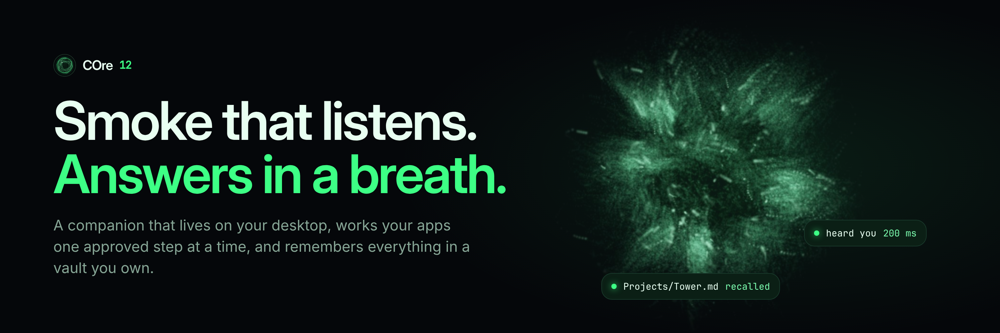
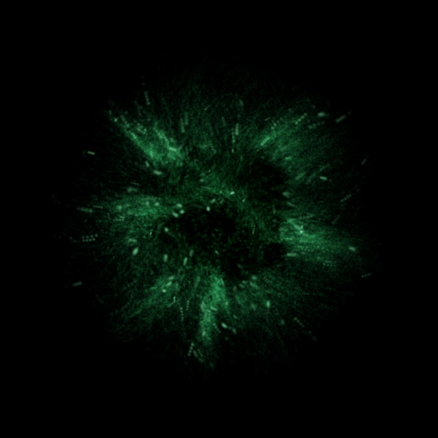
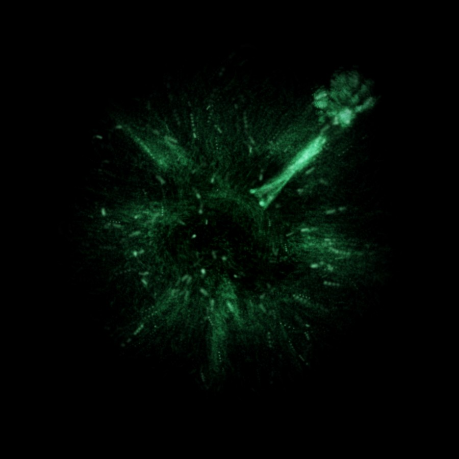
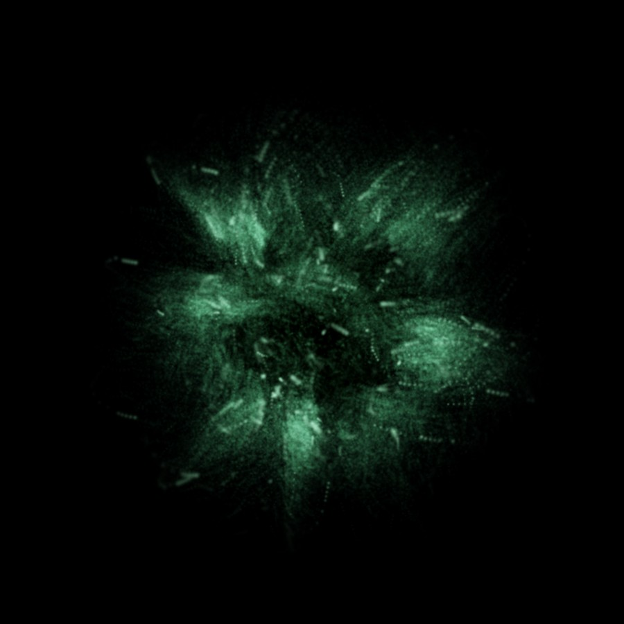
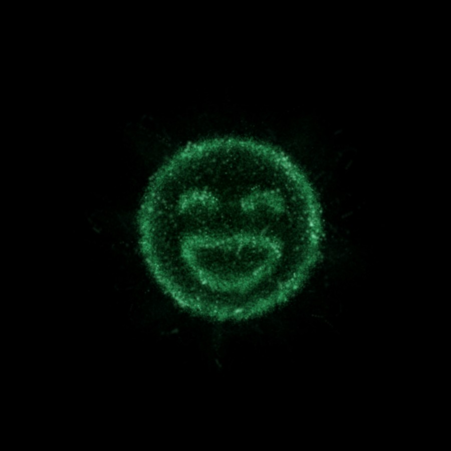
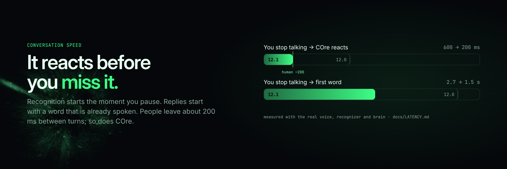
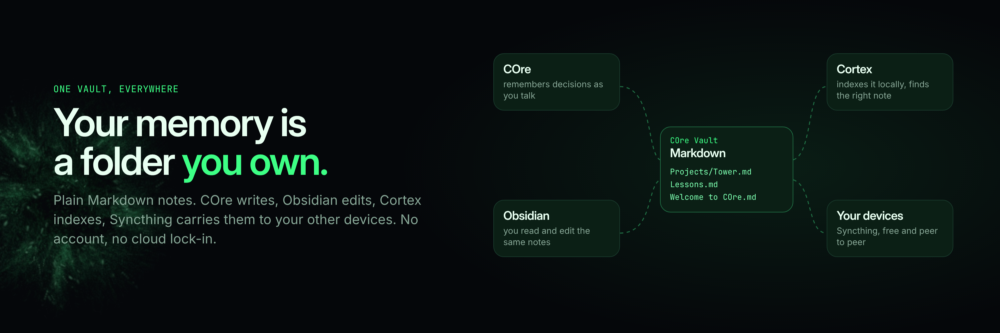
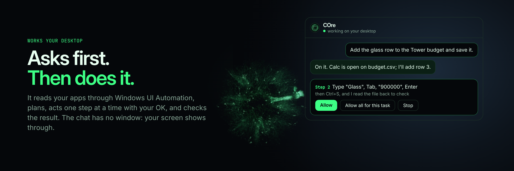

<p align="center">
  
</p>

<p align="center">
  
  
  
  
</p>

<p align="center">
  <b><a href="https://github.com/rawsushies/core-ai-companion/releases">Download</a></b> ·
  <a href="#talk-to-it-like-a-person">Voice</a> ·
  <a href="#it-remembers-in-a-vault-you-own">Memory</a> ·
  <a href="#it-works-your-desktop-with-permission">Desktop</a> ·
  <a href="#privacy-by-design">Privacy</a> ·
  <a href="#build-it">Build</a>
</p>

COre is not a chatbot in a window. It is a sphere of glowing smoke that lives on your desktop: it hears you,
answers out loud, points at things with smoke hands, works your apps when you ask, and remembers your projects
in plain notes you own. Dry-witted by default. Quiet when you're busy.

<table>
  <tr>
    <td></td>
    <td></td>
    <td></td>
    <td></td>
  </tr>
</table>

---

## Talk to it like a person



Press `Ctrl+Alt+Space`, hold the orb, or say **"Hey COre"**, and just talk. Speech recognition starts the moment
you pause. COre shows it heard you within about 200 ms, the gap people leave between turns. It often starts
its answer with a word it has already rendered, so the voice comes in as soon as the brain does. Talk over it
and it stops to listen.

| Do this | And COre… |
|---|---|
| `Ctrl+Alt+Space` / hold the orb | listens; sends when you stop or let go |
| "Hey COre" (optional) | wakes hands-free, "Hey COre, what time is it?" works in one breath |
| `Ctrl+Alt+S` | looks at your screen and can point at things |
| `Ctrl+Alt+C` · `Ctrl+Alt+H` | shows the chat · hides COre (it dissolves into smoke) |
| Type in the chat | answers like a normal chat (markdown, code), read aloud as it goes |

Voice: Kokoro neural voice through a robot effects chain, words revealed in step with the audio. Recognition:
local Whisper. Both run on your PC and ship with the installer. Tone, pitch, voice and reply language are yours
to pick. Every number above is measured, not promised: [docs/LATENCY.md](docs/LATENCY.md), `/diagnostics`.

## It remembers. In a vault you own.



Decisions, lessons and research go into a folder of plain Markdown notes: **COre Vault** in your Documents,
created on first start. [Cortex](https://github.com/rawsushies/cortex-ai-brain), built in, indexes it locally,
so COre recalls the right note and **says where it came from**. Open the same folder in **Obsidian** (COre adds it
to Obsidian for you; no account, no key) and edit anything: COre picks up your changes. Share it with your other
devices through **Syncthing**, free and peer to peer. If two devices edit one note at once, both versions are
kept until you merge them.

`/vault` shows the vault, Cortex, sync and any conflicts · `/obsidian [note]` opens it · `/vault obsidian`
installs Obsidian. How it works: [docs/VAULT.md](docs/VAULT.md).

## It works your desktop. With permission.



Turn on the agent (Settings → Agent) and type `/do` and a task. COre reads your apps through Windows UI
Automation, writes a short plan, acts one step at a time with your OK, and checks the result: it reads the saved
file back instead of trusting the screen. It knows how Excel, Word, LibreOffice, Explorer, browsers, VS Code
and Archicad work best, and learns from your finished tasks. Commands run in a Windows sandbox that can only
touch the folders you allow. `Esc` stops everything. [docs/dev/AGENT.md](docs/dev/AGENT.md)

It also notices what needs you (`/suggest`): an interrupted task, an overdue to-do in your vault, an automation
that failed. Nothing runs until you pick it.

## A body made of smoke

**30 gestures** (wave, shrug, count to five, heart hands, facepalm…) and **shapes with sounds** (a laughing face
that giggles, a heart that hums, a check mark that dings). Pet it, poke it, toss it across the screen. After a
quiet while it may start a short, relevant conversation, never in quiet hours, and it backs off when ignored.
Every window it opens has no fill: your screen shows through, with only the text and controls drawn solid.

<details>
<summary><b>Everything else</b></summary>

| | |
|---|---|
| **Meiosis Mode** | Three specialists split off as smoke helpers: Scout (research), Forge (build), Sentinel (review). `@Scout …` talks to one; address several for a shared task. [docs/dev/MEIOSIS.md](docs/dev/MEIOSIS.md) |
| **Screen partner** | Offers **Take a look** when an error dialog or "(Not Responding)" window appears. Window titles only until you click. |
| **Project reading** | Share one folder: COre and its cores can list, read and search it. Changes are proposed as diffs and applied only when you click; every change can be undone. |
| **Skills** | Notes, timers, weather, music, apps from a safe list, calendar (ICS), web search buttons. Instant answers (time, next song, lyrics) skip the brain. Plugins are JSON link templates in `skills/`. |
| **Glance** | "What's playing?" or "show me the lyrics" puts a small card beside the orb. |
| **Automations** | File and window events can start approved playbooks; results are verified (`/automations`). |
| **Phone** | Pair with a QR code and chat end-to-end encrypted over Wi-Fi. The Android app also works away from home with Gemini. [docs/dev/MOBILE.md](docs/dev/MOBILE.md) |
| **Backups** | Settings, memories, notes and plugins to any folder (OneDrive/Drive/Dropbox = cloud), optionally encrypted. Never API keys. |
| **Notifications** | Anything can ping COre on `127.0.0.1:47321` with the per-install token. |
| **Make it yours** | Seven smoke colours, size, density, battery/balanced/quality profiles, reduced motion, larger text, start with Windows. |

</details>

## Brains

COre picks a brain per request (what it needs, measured speed, health) and fails over without losing the
conversation. Plain conversation is routed at once on your PC; harder requests get a quick second opinion from
**Jev**, COre's decision layer.

| Brain | |
|---|---|
| **Claude** (default) | Claude Code with your own login, no API key. Kept warm in the background. |
| **Gemini · Groq · OpenRouter** | Free API keys. COre picks a current model from each live list and moves off retired or busy ones. Keys are encrypted with your OS account. |
| **Ollama** | Fully offline local model. |
| **Custom** | Any OpenAI-compatible endpoint (DeepSeek, LM Studio…). |

Verified against the live APIs: [docs/REAL-PROVIDERS.md](docs/REAL-PROVIDERS.md).

## Privacy, by design

- **Microphone** opens only while COre listens. Hands-free mode checks short phrases on your PC only. Speech and
  voice never leave your PC.
- **Screen** is captured only when you ask (`Ctrl+Alt+S`, "look at this", **Take a look**).
- **Every action asks first.** Commands run sandboxed. Text from files, web pages and notes is treated as data,
  never as instructions, and suspected injections are flagged.
- **Your knowledge is your folder.** History is never imported silently, and Cortex's index stays on your PC.
- **Crash reports** stay in COre's logs folder. Nothing is uploaded.

## Install

**Windows:** download `COre-Setup-12.1.0.exe` from [Releases](https://github.com/rawsushies/core-ai-companion/releases)
and run it. It includes everything: Cortex, the speech and voice models, the memory model. COre works offline
from the first start and updates itself from published releases. **Android:** `COre-android-12.1.0.apk` from the
same release; pair it in Settings → Phone.

For the Claude brain, install [Claude Code](https://docs.claude.com/en/docs/claude-code) and log in once; or add
a free Gemini/Groq/OpenRouter key in Settings → Brain.

<details>
<summary>If your antivirus removes COre</summary>

The installer isn't code-signed yet, so some antivirus programs (AVG, Avast and others) quarantine `COre.exe` as a
false positive. Restore it from quarantine with an exception, or add an exception for
`%LOCALAPPDATA%\Programs\COre` and run the installer again. Your settings and memory in `%APPDATA%\COre` are not
touched. You can report the false positive to the vendor (AVG: avg.com/false-positive-file-form).
</details>

<details>
<summary>Black box behind the orb?</summary>

Some graphics drivers can't draw transparent windows on the GPU. COre notices and restarts in safe graphics
mode; you can also pick it in Settings → Look → Graphics mode or the tray menu.
</details>

## Build it

Node.js 20+. On Windows, **Install COre.bat** sets everything up from a source folder.

```bash
npm install
```

```bash
npm start
```

```bash
npm test
```

`npm run check` (syntax, duplicate functions, one version everywhere), `npm run e2e` (the real app, virtual
display), `npm run benchmark:latency` (response times with the real components). Releases go through gated CI
and land as drafts a human publishes: [docs/dev/RELEASING.md](docs/dev/RELEASING.md). Progress and evidence:
[ROADMAP.md](ROADMAP.md).

<details>
<summary>Under the hood</summary>

```
 voice / chat / hotkeys ─► main process (Electron)
   ├─ brain: router (capability, speed, health) ► Claude · Gemini · Groq · OpenRouter · Ollama · custom
   │    stream ► tags ► sentence chunker ► [say | gesture | form | skill | agent step]
   ├─ memory gateway ► COre active memory + Cortex (MCP) ► Markdown vault ◄ Obsidian, Syncthing
   ├─ Whisper + Kokoro (worker threads, local) · latency tracer · agent (UI Automation, sandbox)
   └─ settings, command center, monitor (built ahead of time) · notify server 127.0.0.1:47321
                     │ IPC
 overlay (transparent, always on top) ─ WebGL2 smoke particles, gestures, shapes, voice, mic + VAD
```

The smoke uses simplex noise with analytic gradients by Ian McEwan and Stefan Gustavson (ashima/webgl-noise,
MIT), and signed-distance-field techniques from Inigo Quilez's articles. Open
`src/renderer/overlay/index.html` in Chrome to play with the orb without Electron.
</details>

---

<p align="center">
  <br>
  <sub>Capital C, capital O, lowercase "re". The O is the orb. Brand kit: <a href="docs/BRAND.md">docs/BRAND.md</a></sub>
</p>
