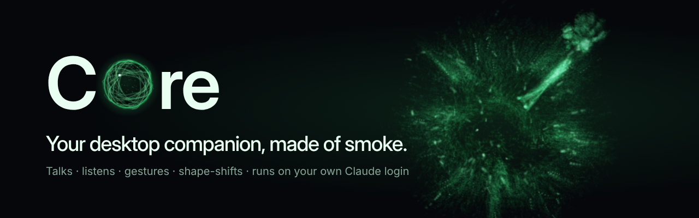
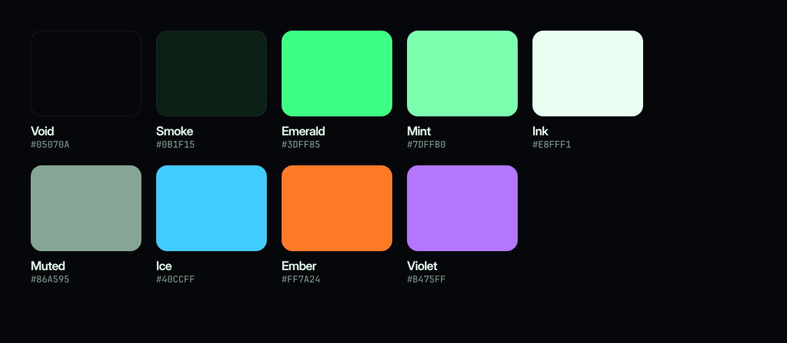

# COre brand guide



COre is a companion made of smoke: curious, dry-witted, helpful. The brand should feel like that: a dark
desktop, one glowing presence, very few words.

## Name

Always **COre**: capital C, capital O, lowercase "re". The O is the orb. Never "Core", "CORE" or "CoRe".
In running text it's just COre; no "the".

## Logo

| Asset | Use |
|---|---|
| `assets/brand/logo-mark.svg` / `.png` | The mark: a sphere of smoke filaments around a dark core. Use on dark backgrounds. |
| `assets/brand/logo-mark-tile.svg`, `icon-*.png` | App icon (rounded tile on Void). `assets/icon.png` is the 512 px app/installer icon. |
| `assets/brand/logo-glyph.svg`, `assets/tray*.png` | Tiny sizes (16–48 px): a bold ring. The filament mark turns to mush below ~64 px. |
| `assets/brand/wordmark.png` (transparent) / `wordmark-dark.png` | "C [orb] re" in Inter Display SemiBold. |

- Clear space around the mark: at least half its width.
- Minimum size: mark 64 px, glyph 16 px, wordmark 120 px wide.
- Don't recolour the mark outside the palette, add outlines, stretch it, or put it on busy or light photos.
  On light backgrounds, place the tile version (`logo-mark-tile`).

## Colour



| Name | Hex | Role |
|---|---|---|
| Void | `#05070A` | Backgrounds. Almost black, slightly blue. |
| Smoke | `#0B1F15` | Panels, the dark core. |
| Emerald | `#3DFF85` | COre itself: the glow, highlights, one accent word per layout. |
| Mint | `#7DFFB0` | Filaments, monospace details. |
| Ink | `#E8FFF1` | Headlines and body text on Void. |
| Muted | `#86A595` | Secondary text. |
| Ice / Ember / Violet | `#40CCFF` / `#FF7A24` / `#B475FF` | Helper clones and themes only, never as a second brand colour. |

Emerald is light: never put white text on it, and use it sparingly. Big emerald areas stop looking like a glow.

## Type

- **Inter Display SemiBold**, tight tracking (−3%): headlines and the wordmark.
- **Inter**: body copy.
- **JetBrains Mono**: shortcuts, commands and small technical details (`Ctrl+Alt+Space`, `"Hey COre"`).

## Imagery

Use real renders of COre's smoke, never illustrations of it. `assets/brand/renders/` has idle, speaking,
waving, thumbs-up, celebrating, heart hands, laughing-face and heart shapes, pointing, and the Ice/Ember/Violet
themes. They're on pure black, so they blend into Void with `mix-blend-mode: screen`. Capture more from the orb
demo page:

```bash
node scripts/brand/build.js
```

(The build script regenerates every logo, icon and banner. New renders come from
`src/renderer/overlay/index.html?pose=gesture&g=wave&at=1&r=130&bg=brand`.)

## Voice

COre talks like it looks: short, dry, a little theatrical, never mean.

- Lead with what it does, not with technology: "It laughs at its own jokes. In smoke." beats "Particle-based emoji rendering".
- One idea per line. Fragments are fine.
- Wry, not snarky. COre teases the situation, never the user.
- Say what's private and local plainly: "Runs on your PC. Nothing leaves it."

Taglines in use: *Your desktop companion, made of smoke.* · *Not a chatbot. A presence.* · *Many COres. One desktop.*
· *Pet it. Poke it. Toss it.*

## Kit

| File | Size | For |
|---|---|---|
| `banner-readme.png` | 1280×400 | README header |
| `social-preview.png` | 1280×640 | GitHub social preview (repo Settings → Social preview), link cards |
| `promo-features.png` | 1200×628 | Feature announcement, Product Hunt gallery, Open Graph |
| `promo-header.png` | 1500×500 | X / Twitter header |
| `promo-square.png` | 1080×1080 | Instagram / Mastodon / Discord posts |
| `promo-story.png` | 1080×1920 | Stories, Shorts, TikTok cover |
| `icon-1024/512/256/128.png` | square | Store listings, app icon |
